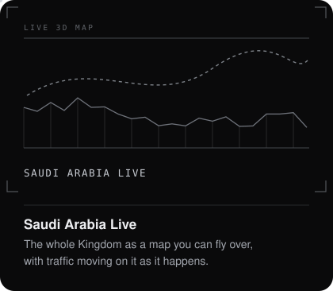

<picture><source media="(prefers-color-scheme: dark)" srcset=".github/brand/hero-dark.svg"><source media="(prefers-color-scheme: light)" srcset=".github/brand/hero-light.svg"></picture>

<a href="https://mansouri.uk">
<picture><source media="(prefers-color-scheme: dark)" srcset=".github/brand/site-dark.svg"><source media="(prefers-color-scheme: light)" srcset=".github/brand/site-light.svg"></picture>
</a>

<picture><source media="(prefers-color-scheme: dark)" srcset=".github/brand/tile-saudi-live-dark.svg"><source media="(prefers-color-scheme: light)" srcset=".github/brand/tile-saudi-live-light.svg"></picture>
<picture><source media="(prefers-color-scheme: dark)" srcset=".github/brand/tile-explainer-dark.svg"><source media="(prefers-color-scheme: light)" srcset=".github/brand/tile-explainer-light.svg"></picture>

<picture><source media="(prefers-color-scheme: dark)" srcset=".github/brand/tile-minuteman-dark.svg"><source media="(prefers-color-scheme: light)" srcset=".github/brand/tile-minuteman-light.svg"></picture>
<picture><source media="(prefers-color-scheme: dark)" srcset=".github/brand/tile-ar-dark.svg"><source media="(prefers-color-scheme: light)" srcset=".github/brand/tile-ar-light.svg"></picture>

<picture><source media="(prefers-color-scheme: dark)" srcset=".github/brand/every-screen-dark.svg"><source media="(prefers-color-scheme: light)" srcset=".github/brand/every-screen-light.svg"></picture>

<picture><source media="(prefers-color-scheme: dark)" srcset=".github/brand/stack-dark.svg"><source media="(prefers-color-scheme: light)" srcset=".github/brand/stack-light.svg"></picture>

<a href="https://mansouri.uk">
<picture><source media="(prefers-color-scheme: dark)" srcset=".github/brand/start-dark.svg"><source media="(prefers-color-scheme: light)" srcset=".github/brand/start-light.svg"></picture>
</a>

