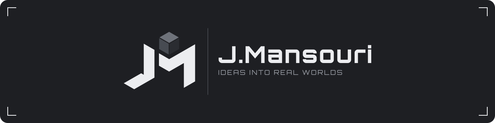
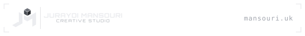

<picture>
  <source media="(prefers-color-scheme: dark)" srcset=".github/brand/banner-dark.svg">
  <source media="(prefers-color-scheme: light)" srcset=".github/brand/banner-light.svg">
  
</picture>

# J.Mansouri

Developer and designer building XR, games, apps and tools.

## Focus

| Area | What I build |
|---|---|
| XR and AR | Training tools, mixed-reality prototypes, AR learning flows |
| Games | Unity projects, classroom games, interaction systems |
| Apps | Flutter, desktop, mobile and offline tools |
| Systems | Self-hosted workflows, dashboards, automation and release pipelines |

## Selected Work

| Project | Type |
|---|---|
| J.Mansouri | Brand, website and design system |
| MansouriXR Studio | Design engine and design-system workspace |
| Saudi Arabia Live | 3D live map of the Kingdom |
| Blueprint Studio | Floor plan to 3D building editor |
| The Aurora Project | Device mockup showcase for the apps |
| Minuteman | Meeting assistant for Windows and iPhone |
| AR Art Studio | Printed artwork to AR workflow |
| QR Asset Registry | Unity Android inventory app |
| ALC Quiz Arena | Classroom quiz system |

## Stack

  

## Contact

- GitHub: [github.com/ijraidy](https://github.com/ijraidy)
- Website: [mansouri.uk](https://mansouri.uk)

---

  <a href="https://mansouri.uk">
    <picture>
      <source media="(prefers-color-scheme: dark)" srcset=".github/brand/signature-dark.svg">
      <source media="(prefers-color-scheme: light)" srcset=".github/brand/signature-light.svg">
      
    </picture>
  </a>

